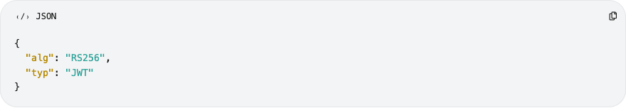

# kame-layout

Scrapbox / Cosense の見た目と編集機能を拡張する UserCSS・UserScript 集です。配色、ページ一覧、文字装飾、チェックボックス、検索・置換、表計算、グラフ表示などを管理しています。

**何ができるかは [72機能の一覧](docs/features.md) から確認できます。** 各機能の README に、使い方・有効状態・CSS/JS の役割・ソース・出典をまとめています。

ピン留めタイトルは、長い場合も1行に収めて末尾を「…」で省略します。[変更前後の比較と確認方法](docs/pinned-titles.md)


コードブロックは、右上のコピー操作を残した角丸グレーのパネルに整えます。[変更前後とスマートフォン幅](docs/code-blocks.md)



## Scrapbox で使う

現在は **GitHubを編集元、[kame-layout:delivery](https://scrapbox.io/kamelayout/kame-layout%3Adelivery) の1ページを配信元**にしています。`main` へのpush後にGitHub Actionsが検証・同期し、Scrapboxを再読み込みすると更新されます。iPhone・iPadも標準のUserCSS／UserScriptで利用できます。

- **UserCSS**：設定済みの `kamekingdom/Settings` に結合済みCSSを自動配置し、最初の描画から適用します。
- **UserScript**：ユーザーページの次の入口から最新版を読み込みます。プロフィール設定のUserScriptをEnabledにします。

```text
code:script.js
 import(`/api/code/kamelayout/kame-layout%3Adelivery/loader.js?reload=${crypto.randomUUID()}`).catch(console.error);
```

**更新はActionsの配信成功後に再読み込みしてください。** 既に開いている画面のScriptは自動で差し替えません。利用先SettingsのCSSはScript起動後に交換しないため、旧UIから新UIへの切り替わりを避けられます。

別のプロジェクトへ導入する場合は、[自動同期の設定](docs/auto-sync.md)で配信先・UserCSSの適用先・認証を設定します。[更新の仕組み](docs/fresh-delivery.md)にキャッシュ対策と切り替え手順をまとめています。同じ機能の旧importは重複登録を避けるため置き換えてください。

GitHubやjsDelivrへの直接importはScrapboxのCSPでブロックされるため、同じ `scrapbox.io` の `/api/code/` を使います。自動同期を利用しない場合は [生成JSON](dist/kame-layout.scrapbox.json) をSettings → Page Data → Import Pagesで取り込み、次のCSS入口を使えます。この固定URLの方式には配信キャッシュの更新待ちがあります。[公式インポート手順](https://scrapbox.io/help-jp/Import_Pages_%2F_Export_Pages)

```text
code:style.css
 @import url("/api/code/kamelayout/kame-layout%3Adelivery/style.css");
```

## 構成

```text
style.css / script.js     生成される読み込み順の入口
config/features.json      機能の説明、有効・無効、読み込み順
config/scrapbox-sync.json  同期先プロジェクトと配信用ページ
src/features/<機能ID>/    機能ごとの CSS・JS・設定データ・README
src/theme/project.css     プロジェクト共通変数
src/templates/            抽出したテンプレート本文
docs/                     機能一覧、構成の理由、開発手順
tools/                    入口とドキュメントの生成、検証
tests/                    回帰・機能・配信の検証
tests/fixtures/original/  初回移行の出典・ハッシュ・対応表
dist/                     配信JSONと標準UserCSSの生成物
.github/workflows/         検証とmainへのpush後の自動同期
```

機能単位に CSS・JS・説明をまとめ、[設定ファイル](config/features.json) から入口と機能一覧を生成します。実行時に設定 JSON を取得する処理や、新しい UI フレームワークは加えていません。CSS の優先順位と Script の実行順は元の構成を維持しています。

変換ルールは [replacements.js](src/features/auto-replace/replacements.js)、テンプレートの定義は [templates.js](src/features/templates/templates.js) のように、処理本体と分けています。

大きなCSSは `cells.css`・`header.css` など表示部分ごとに分け、機能の `style.css` で順序を管理します。配信時には機能ごとに結合します。Scriptは `script.js` に初期化・イベント・状態を残し、計算・解析・DOM部品を補助モジュールへ分けています。例えば表計算の [engine.js](src/features/spreadsheet/engine.js) は画面なしで検証できます。各READMEの表からファイルの役割を確認できます。

- [機能一覧・各 README](docs/features.md)
- [読み込み順](docs/load-order.md)
- [構成の理由と維持するルール](docs/architecture.md)
- [編集・検証の手順](docs/development.md)
- [自動同期・認証・復旧の手順](docs/auto-sync.md)
- [出典・参考リンク](SOURCES.md)
- [整理した旧版・ページと復旧方法](docs/cleanup.md)

## 開発する

Issue・作業ブランチ・PR・検証・マージの進め方は [CONTRIBUTING.md](CONTRIBUTING.md) を参照してください。

Node.js 22.13 以降と、初回コミットを含むGit履歴が必要です。

```sh
npm ci
npm run build
npm run check
npm test
```

`npm run build` は公開入口・機能 README・Scrapbox 用 JSON を更新します。`src/features/` のコードは生成物ではないため直接編集できます。機能の説明や初期設定を変える場合は `config/features.json` を編集してください。

## 元コードと既存の依存関係

元 JSON から抽出した CSS 82・JS 37・テンプレート12の計131ファイルは、現行コードまたはGit履歴へ対応付けています。変更前は [初回コミット](https://github.com/kamekingdom/kame-layout/tree/68d00aaefdcc5504d59727c23cbe457e38cff19d)、出典は [manifest.json](tests/fixtures/original/manifest.json)、移動先は [paths.json](tests/fixtures/original/paths.json) で追えます。ユーザー情報を含む元 JSON は公開していません。

元の CSS 入口にあった3件の参照切れは、効果のない import として現行入口から除きました。別の装飾を代わりに有効にすることはしていません。グラフの CSS は従来通り Script が読み込みます。

テンプレートの取得先、アイコン・画像・フォント・外部モジュールへの参照は各 README に記載しています。特にテンプレートは動作維持のため、従来の `kamelayout` の API から取得する構成です。取得先の変更は [templates.js](src/features/templates/templates.js) で行えます。

## 参考

- [Scrapbox UserCSS](https://scrapbox.io/help-jp/UserCSS)
- [Scrapbox UserScript](https://scrapbox.io/help-jp/UserScript)
- [jsDelivr の GitHub 配信](https://github.com/jsdelivr/jsdelivr#github)
