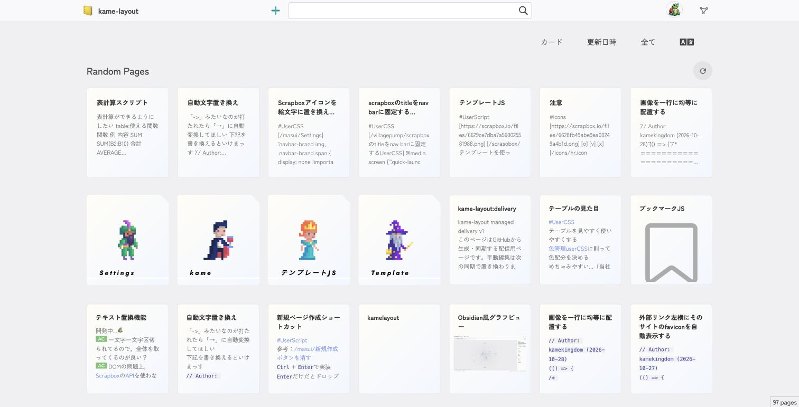

# 旧版と配信ページの整理

Issue [#19](https://github.com/kamekingdom/kame-layout/issues/19) の整理記録です。現行CSS・Scriptの処理と、有効・無効の設定は維持します。

## GitHub

- 重複していた旧版・試作37ファイルとアーカイブ用READMEを作業ツリーから削除。各機能READMEから固定した初回コミットへ参照できます。
- 初回抽出だけで使った `tools/extract.py` と、現行配信から使われない `src/Settings/style.css`・`src/kame/script.js` を削除。
- `migration/` の3記録を `tests/fixtures/original/` へ移動。初回131ファイルの追跡・ハッシュ・回帰比較は維持。
- READMEの導入説明を、現在の1ページ配信と標準UserCSSの自動配置を中心に整理。
- 任意・無効の機能は削除せず、設定から引き続き選択できます。
- mainへ取り込み済みで未マージPRのない作業ブランチ12本を削除。再生成できるローカルのブラウザ検証出力も整理しました。

## Scrapbox

対象は、以前の複数ページ配信で生成した `kame-layout:*` の73ページです。現在の `kame-layout:delivery` は除外します。整理前170ページから、整理後97ページになりました。削除した73ページが一覧に存在せず、残した97ページの本文が処理前後で一致することを確認しました。

削除前に全170ページのScrapbox形式JSONとAPI応答をリポジトリ外へバックアップしました。削除候補のID・本文ハッシュを照合し、残すページに旧配信の参照がないことも確認しました。通常の配信処理には削除機能を追加しません。

次のページは維持します。

- `kame-layout:delivery`：現在の118コードブロックの配信元。
- `Settings`・`kame`・日本語の機能解説ページ：元の利用入口と出典。旧生成ページを参照していません。
- `Template`：現行Scriptから6種類のテンプレートを取得するAPI参照先。
- `AC`・`NWJ`・`WJ`・`WA`・`RE`・`TLE`・`豆電球`など：本文へ挿入するアイコンの参照先。
- 画像・使い方・日記などの既存ページ。アップロード済みファイルも削除しません。

削除する旧生成ページ73件

- `kame-layout:answer-lines`
- `kame-layout:audio-player`
- `kame-layout:auto-replace`
- `kame-layout:bookmark-menu`
- `kame-layout:bookmark-style`
- `kame-layout:brand-icon`
- `kame-layout:card-size`
- `kame-layout:character-counter`
- `kame-layout:checkbox-style`
- `kame-layout:checkbox-toggle`
- `kame-layout:code-blocks`
- `kame-layout:code-line-numbers`
- `kame-layout:colors`
- `kame-layout:custom-bullets`
- `kame-layout:double-quote`
- `kame-layout:entry`
- `kame-layout:equal-image-rows`
- `kame-layout:expanded-sort-menu`
- `kame-layout:external-favicons`
- `kame-layout:figure-numbers`
- `kame-layout:file-buttons`
- `kame-layout:find-replace`
- `kame-layout:fonts`
- `kame-layout:graph-view`
- `kame-layout:grid-layout`
- `kame-layout:hashtags`
- `kame-layout:header-image`
- `kame-layout:header-width`
- `kame-layout:headings`
- `kame-layout:hide-plan-badge`
- `kame-layout:hide-untitled`
- `kame-layout:hierarchy-fold`
- `kame-layout:icon-menu`
- `kame-layout:image-center`
- `kame-layout:image-gallery`
- `kame-layout:image-size`
- `kame-layout:indent-guides`
- `kame-layout:infobox`
- `kame-layout:inline-quote`
- `kame-layout:katex-spacing`
- `kame-layout:legacy-character-count`
- `kame-layout:link-colors`
- `kame-layout:link-preview`
- `kame-layout:marquee`
- `kame-layout:math-bullets`
- `kame-layout:menus`
- `kame-layout:muted-text`
- `kame-layout:navbar-title`
- `kame-layout:new-page-shortcut`
- `kame-layout:numbered-lists`
- `kame-layout:on-this-day`
- `kame-layout:page-cards`
- `kame-layout:page-layout`
- `kame-layout:pinned-backgrounds`
- `kame-layout:pinned-menu`
- `kame-layout:project-completion`
- `kame-layout:quick-launch`
- `kame-layout:quote-bar`
- `kame-layout:random-pages`
- `kame-layout:sort-lines`
- `kame-layout:spreadsheet`
- `kame-layout:status-icons`
- `kame-layout:sticky-notes`
- `kame-layout:table-copy`
- `kame-layout:tables`
- `kame-layout:template-style`
- `kame-layout:templates`
- `kame-layout:text-alignment`
- `kame-layout:text-decorations`
- `kame-layout:two-column-links`
- `kame-layout:underwater-home`
- `kame-layout:untitled-prompt`
- `kame-layout:wide-dropdown`

## 検証と復旧

ローカルの `npm run build`・`npm run check`・38件のテストが成功しました。整理前後の118コードブロックと標準UserCSSは、配信版ハッシュを置換するとバイト単位で一致します。説明文だけの変更でも版ハッシュは更新されます。Chromium・WebKitの配信テストも成功しました。[一回限りの整理処理と検証結果](https://github.com/kamekingdom/kame-layout/actions/runs/44032837557)をActionsに記録しています。削除処理は登録済みSecretで認証したWebSocket経由の通常ページ削除です。実施用コードとjobは終了後に現行ツリーから取り除きました。

削除したページは、メンバー権限で左上メニュー → Stream → Eventsから30日以内ならRestoreできます。[公式の復旧方法](https://scrapbox.io/help-jp/最近削除したページ)

バックアップJSONはローカルの `../kame-layout-backups/2026-11-17/kamelayout.scrapbox.json` にあります。長期保存用のバックアップは公開リポジトリへコミットしません。JSONから復元するときは、復元したい旧ページだけを抽出してImport Pagesへ取り込んでください。全ページを一括で戻すと、その後の変更も上書きするためです。

## 整理後の一覧

2026-11-17、Chromeで公開プロジェクト `kamelayout` を再読み込みした一覧です。ページ数97件と旧生成ページ0件をAPIでも照合しました。現在の配信ページと元の解説ページを残しています。

