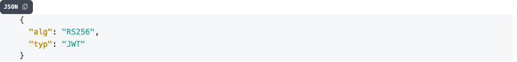

# コードブロックの表示

薄いグレーの背景と角丸のパネルにまとめ、ヘッダー左にコード記号と標準のファイル名、右に標準のコピーボタンを表示します。ファイル名のリンク・シンタックスハイライト・既存の行番号は維持します。

参考画像の折り返し切替ボタンは追加していません。折り返しは従来のScrapboxの動作を維持します。CSSだけを変更し、本文を書き換えるScriptや疑似的な操作ボタンは追加していません。

## 変更前



## 変更後


## スマートフォン幅


## 撮影と検証

2026年11月17日撮影。Scrapboxの標準DOMと同じ構造の確認用ページに、変更前後のCSSを適用した表示です。画像の本文はサンプルJSONであり、個人ページの本文は含みません。

Chrome・WebKitで画面幅1440・834・390pxを確認し、ヘッダーと本文の左右端、隣接・入れ子・空のブロック、長いファイル名、コピーボタンの表示、文字列とハイライトの維持を検査しました。公開のScrapboxページでも標準コピーの結果と本文が変更前後で一致することを確認しています。ログイン後の編集操作とiPhone・iPad実機は未確認です。

```sh
node tools/code-blocks-check.mjs
node tools/code-blocks-check.mjs --webkit
```

比較画像は `.cache/code-blocks/<engine>/` に出力します。`--live` は公開済みCSSを読み込みます。通常URLの配信キャッシュによって反映が遅れる場合があるため、保存内容の照合とは分けて確認します。

- [Issue #8](https://github.com/kamekingdom/kame-layout/issues/8)
- [機能の構成](../src/features/code-blocks/README.md)
