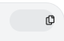
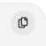
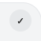
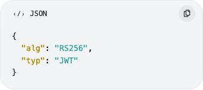
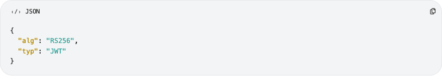
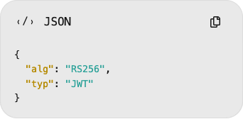
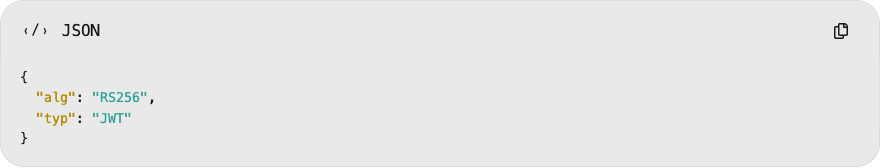
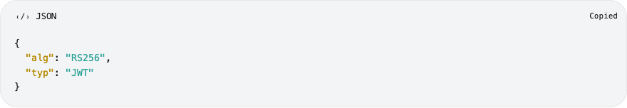
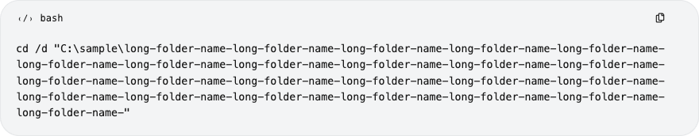
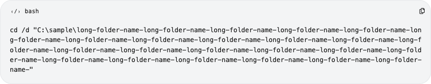

# コードブロックの表示

薄いグレーの背景と角丸のパネルにまとめ、ヘッダー左にコード記号と標準のファイル名、右に標準のコピーボタンを表示します。ファイル名のリンク・シンタックスハイライト・既存の行番号は維持します。

参考画像の折り返し切替ボタンは追加していません。長いパスやトークンが単語の境界で早く改行されないよう、カード内の右端近くまで使って折り返します。CSSだけを変更し、本文を書き換えるScriptや疑似的な操作ボタンは追加していません。

## 円形のコピー操作

コピー領域を28×28pxの円形に揃え、アイコンを円の中央に配置します。右端から12pxの余白を取り、右へ寄りすぎない位置に調整しました。コピー完了時は同じ円内のチェック表示に切り替わり、領域・ヘッダー・本文の寸法と位置を維持します。標準コピーが返す文字列や実際の改行は変更しません。

変更前（横長の背景と右寄せ）：



変更後・コピー完了時：






2026-11-17撮影。標準DOMの確認用ページです。Chromium・WebKit、1440・834・390pxで円形・アイコンの中央配置・ヒット領域・完了時の寸法を確認しました。実際の公開ScrapboxページではChromiumで円の中央と左右端をクリックしてコピー結果が変わらず、円の外側の角ではコピーされないことを確認しています。古いスタイルと混在した場合も、新しい寸法が適用される条件で検証しています。iPhone・iPad実機の確認とは区別します。

再撮影：`node tools/code-blocks-check.mjs --copy-baseline`。関連：[Issue #23](https://github.com/kamekingdom/kame-layout/issues/23)。

## 変更前


## 変更後



## スマートフォン幅



## ヘッダーの小型化とコピー完了表示

ラベルとアイコンを12pxに、ヘッダーの上下余白を8pxに抑えています。背景も `#f3f4f5` の薄いグレーへ変更しました。当初は標準コピーの「Copied」表示に合わせて操作領域を56×28pxにしていました。現在は上記の28×28pxの円形に揃え、チェック表示でもヘッダーと本文の位置を維持します。

小型化前：



小型化後・コピー完了時：



2026年11月17日に同じ確認用DOMで撮影。通常表示とCopied表示のヘッダー・操作領域・本文の寸法と位置をChrome／WebKitの各画面幅で照合しています。実際のScrapboxのコピー操作でも、通常時とCopied時のヘッダー・操作領域の幅と高さが一致することを確認しました。

再撮影：`node tools/code-blocks-check.mjs --header-baseline`（小型化前との比較）。関連：[Issue #10](https://github.com/kamekingdom/kame-layout/issues/10)。

## 本文幅とコピー位置

右側の余白を12pxに減らし、コード本文は `word-break: break-all` で右端近くまで使って折り返します。表示上の折り返しだけを変えるため、コピーされるコードや実際の改行は変わりません。この調整ではコピーアイコンを右寄せにしていました。現在は上記の円形領域の中央に揃え、右側に12pxの余白を取っています。

変更前：



変更後：



確認用ページの長いパスで比較しています。ユーザーの実際のコマンドや個人データは掲載していません。再撮影は `node tools/code-blocks-check.mjs --width-baseline` で行います。

## 撮影と検証

2026年11月17日撮影。Scrapboxの標準DOMと同じ構造の確認用ページに、変更前後のCSSを適用した表示です。画像の本文はサンプルJSONであり、個人ページの本文は含みません。

Chrome・WebKitで画面幅1440・834・390pxを確認し、ヘッダーと本文の左右端、隣接・入れ子・空のブロック、長いファイル名、コピーボタンの表示、文字列とハイライトの維持を検査しました。公開のScrapboxページでも標準コピーの結果と本文が変更前後で一致することを確認しています。ログイン後の編集操作とiPhone・iPad実機は未確認です。

```sh
node tools/code-blocks-check.mjs
node tools/code-blocks-check.mjs --webkit
```

比較画像は `.cache/code-blocks/<engine>/` に出力します。`--live` は公開済みCSSを読み込みます。通常URLの配信キャッシュによって反映が遅れる場合があるため、保存内容の照合とは分けて確認します。

- [Issue #8](https://github.com/kamekingdom/kame-layout/issues/8)
- [機能の構成](../src/features/code-blocks/README.md)
