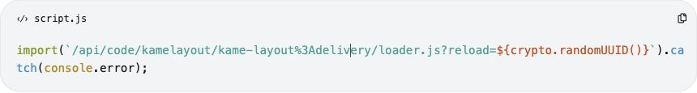

# 最初の表示から最新版を使う

`main`へpushし、GitHub Actionsの配信が成功した後にScrapboxを再読み込みします。ハードリロード・キャッシュ削除・毎回のimport書き換えは不要です。配信中に再読み込みした場合は、ジョブ成功後にもう一度再読み込みしてください。

## CSSは標準UserCSSで最初から表示する

設定済みの利用先では、結合済みのCSSを **Settingsの標準 `style.css` へ自動配置** します。従来の「旧CSSを表示→Scriptで最新CSSへ差し替え」は行いません。画面を隠して待つ処理もありません。

- 設定：[config/scrapbox-sync.json](../config/scrapbox-sync.json) の `usercss`。配置先は `kamekingdom/Settings`。
- 配置内容：[dist/kame-layout.native.css](../dist/kame-layout.native.css)。GitHubの機能別CSSを結合した生成物です。
- 初回は既存の配信importを置き換え、その後は `/* kame-layout:usercss:start */` と `/* kame-layout:usercss:end */` の間だけを更新します。
- マーカー外の独自CSS・本文・他のコードブロックは保持します。独自CSSは生成範囲の後に残るため、従来の優先順位を保ちます。
- 結合によってCSSの親子importがなくなり、旧版の子ファイルだけがキャッシュに残る問題を避けます。Google Fontsの外部importはCSS先頭へ置き、フォントの定義を維持します。

設定済みプロジェクトのローダーは、標準UserCSSの配信バージョンを確認してからScriptを起動します。CSSリンクの追加・差し替え・旧CSSOMの削除は行いません。CSS自体の表示にはUserScriptは不要です。

## Scriptの入口

標準UserScriptを有効にし、ユーザーページの既存の配信用 `script.js` importを次の1行へ置き換えます。切り替え済みの場合、この入口は変更しません。

```text
code:script.js
 import(`/api/code/kamelayout/kame-layout%3Adelivery/loader.js?reload=${crypto.randomUUID()}`).catch(console.error);
```

必要なら標準の「UserScriptを読み込む」を押して再読み込みします。PC・iPhone・iPadとも標準機能で利用できます。iPhone・iPad実機の検証は別途必要です。



画像は2026年11月17日、標準UserCSSへの直接同期後に、実際のScrapboxで撮影した入口です。コードブロック部分だけを掲載しています。入口の再編集はしていません。Scriptがまだ起動していない時点でも、標準UserCSSの配信バージョンと12pxのヘッダーを確認できました。起動後も後置CSSリンクは0件で、右余白12px・コピーアイコンの右端からの距離13pxを確認しています。通常の再読み込みをもう一度行っても、独自CSS・プロフィール本文が維持されました。

毎回異なるURLでローダーを取得し、Scriptの入口・全補助モジュール・Scriptが読む専用CSSへ同じ配信ハッシュを付けます。同じ画面で入口が複数回importされても、イベントやメニューを重複登録しません。

## 配信と設定

公開のコード配置先は引き続き `kame-layout:delivery` の1ページです。それとは別に、明示設定した利用先のSettingsのCSS管理範囲を更新します。認証アカウントには両プロジェクトの更新権限が必要です。[自動同期の設定](auto-sync.md)を参照してください。

新しい利用先では、SettingsにREADMEの従来のCSS importを1行設定してから自動同期を有効にします。マーカーも既知の旧importもない場合は、既存CSSを誤って消さないよう同期を中止します。個人のSettings全文や独自CSSはログ・公開アーティファクトへ保存しません。

`usercss` に設定していないプロジェクトから同じローダーを使う場合は、従来の動的CSS読込へ戻ります。初回描画から標準UserCSSを使うには、そのプロジェクトを配置先へ明示設定してください。

## 検証と復旧

```sh
npm test
node tools/delivery-check.mjs
node tools/delivery-check.mjs --webkit
node tools/code-blocks-check.mjs --width-baseline
node tools/code-blocks-check.mjs --width-baseline --webkit
npm run test:browser -- --native
npm run test:browser -- --native --webkit
```

`delivery-check`は旧キャッシュ・2回の配信・入れ子JS／CSS・二重起動を検証します。標準UserCSSのモードでは、Scriptを遅延させても最初から最新のCSSが表示され、途中で非表示化やCSSの差し替えが起きないことを検査します。旧方式を使う未設定のプロジェクトでは、入口CSSの失敗時に旧CSSを残す動作も検査します。

`test:browser --native` は公開ScrapboxのCSP内で、結合済みCSSとネイティブCSS確認後のScript起動を検証します。テスト用に配置先プロジェクト名だけを公開の確認先へ合わせています。実際の利用先では配信後の通常の再読み込みで確認します。

標準UserCSSの取得やバージョンが配信済みのScriptと一致しない場合、ローダーはCSSを書き換えず、Scriptを起動せずにエラーを記録します。配信成功・接続状態を確認して再読み込みしてください。復旧は戻したいGitの版から再生成・同期します。

- [初回の更新方式：Issue #12](https://github.com/kamekingdom/kame-layout/issues/12)
- [初回表示の改善：Issue #16](https://github.com/kamekingdom/kame-layout/issues/16)
- [自動配信・バックアップ](auto-sync.md)
