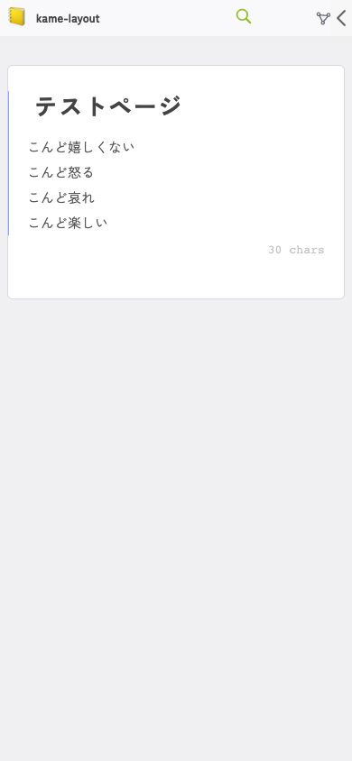

# 既存URLとの互換性

以前から次のURLを利用している人は、import先を変更せずに使えます。`settings`と`Settings`のどちらのScrapbox URLも確認対象にしています。

| 取得先 | 現在の内容 |
| --- | --- |
| `/api/code/kamelayout/Settings/style.css` | 現在の有効設定から結合したCSS。追加の機能別CSS importを行わず、最初の適用時から現在の装飾を使います。 |
| `/api/code/kamelayout/kame/script.js` | `kame-layout:delivery/script.js` の配信ハッシュ付きURLをimportします。CSSの後付けや差し替えは行いません。 |
| [src/Settings/style.css](../src/Settings/style.css) | ダウンロード・Scrapboxへの貼り付けに使える、同じ結合済みCSS。 |
| [src/kame/script.js](../src/kame/script.js) | ダウンロード・Scrapboxへの貼り付けに使える、同じScript入口。 |

CSSとScriptの有効・無効および実行順は、通常の配信と同じ `config/features.json` に従います。Scriptを現行のローダーと併用しても、同じURLのES Moduleは一度だけ評価されます。旧版の個別Scriptを別途直接importしている場合は、その重複導入を解除してください。

## 自動更新の範囲

`config/scrapbox-sync.json` の `legacyEntrypoints: true` で有効にしています。`main` へpushしてCIが成功すると、通常の配信・設定済み利用先の標準UserCSSに加えて、配信元の `Settings` の `style.css` と `kame` の `script.js` を同期します。配信JSON自体は引き続き `kame-layout:delivery` の1ページです。

初回は初回コミットと一致する旧コードのSHA-256を照合してから置き換えます。それ以降は `kame-layout:legacy-css` / `kame-layout:legacy-js` の管理マーカー内だけを更新します。本文・画像・別のコードブロック・マーカー外に追記した独自コードは保持します。重複ブロック・不正なマーカー・認識できない旧コードは、配信を書き込む前の検査で拒否します。ページ削除は行いません。

導入先に元の `Settings`・`kame` ページがない場合や、この互換入口を配信しない場合は `legacyEntrypoints: false` にしてください。

変更前の公開2ページは、Actionsの `previous-delivery-page` アーティファクト内の `previous-legacy.scrapbox.json` に保存します。配信後は従来のURLからコード本文とContent-Typeを照合します。非公開の利用先Settingsは、このバックアップには含めません。

## 更新とキャッシュ

既に開いている画面のScriptや、端末に保存済みのファイル自体は書き換えません。保存したコードを更新したい人は、同じ取得先から再ダウンロードしてください。固定URLをimportする従来方式には、ブラウザや配信キャッシュが残る場合があります。毎回最新版を取得する入口と標準UserCSSへの自動配置は、[現在の導入方法](../README.md#scrapbox-で使う)を参照してください。

## 検証

`npm test` では旧コードの認識、コード外の保持、同時に加わった本文の保持、未知の内容での書き込み拒否、更新前バックアップ、更新不要時の書き込み省略、古いAPI応答の検出を確認します。

`node tools/browser-check.mjs --legacy` は公開テストページのDOMとCSPを使い、生成した互換入口を適用して初回版と比較します。1600・1440・834・390pxでスクリーンショット・計算済みスタイル・文字数カウンター・グラフ開閉を照合します。`--webkit` はSafari系エンジン、配信後の `--live` は公開APIを差し替えない実取得での確認です。iPhone・iPad実機での確認とは区別します。ブラウザがResizeObserverの通知を次フレームへ繰り越した場合の標準通知は、report.jsonの件数に記録します。通知が収束しない場合は失敗にします。ほかのScriptエラー・画面・スタイル・操作の比較は失敗条件のまま維持します。[通知の仕様](https://developer.mozilla.org/en-US/docs/Web/API/ResizeObserver#observation_errors)

下は2026-11-17にChromium・390×844pxで確認した公開テストページです。互換入口のAPI応答は生成コードを返す検証モードです。公開APIの実取得による確認結果はPRに記録します。

