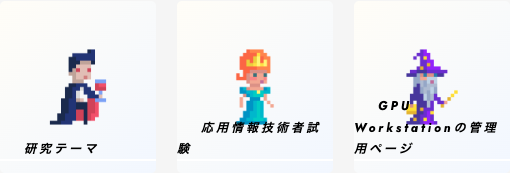
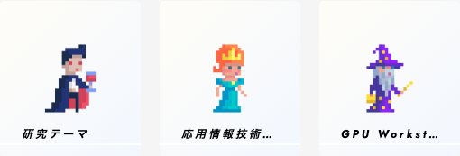

# ピン留めタイトルの表示

長いタイトルは1行に収め、カードの幅を超える部分を末尾の「…」で省略します。短いタイトルの装飾・背景画像と、通常カードの表示は維持しています。タイトルの文字列はそのまま残るため、リンクを開くと全文を確認できます。

## 変更前

長いタイトルが複数行に折り返され、後続行がカードの左端へ寄ったり、画像と重なったりしていました。



## 変更後

左右の余白をタイトルの枠へ移し、文字をカード内に収めています。



## 画像と検証条件

画像はScrapboxと同じカードDOM構造の確認用ページです。個人プロジェクトの画面全体を掲載せず、比較対象の3枚だけを撮影しています。カード幅156px、画面幅1440pxのChromeで、変更前のCSSと公開配信済みCSSをそれぞれ読み込みました。撮影日：2026年11月16日。

Chrome・WebKitで画面幅1440・834・390px、カード幅130・156・200pxを検証済みです。実際のScrapboxでも保存・再読み込み後の表示を確認しました。iPhone・iPad実機での確認は含みません。

再撮影する場合は次を実行し、生成した `before-preview.png` と `after-preview.png` をこのページの画像へコピーします。

```sh
npm run test:pins -- --live
```

出力先：`.cache/pinned-titles/chromium-live/`。公開済みCSSを使うため、対象の変更が配信済みであることを確認してください。

- [Issue #6](https://github.com/kamekingdom/kame-layout/issues/6)
- [CSS修正：PR #4](https://github.com/kamekingdom/kame-layout/pull/4)
- [配信URLと確認手順：PR #5](https://github.com/kamekingdom/kame-layout/pull/5)
- [実装](../src/features/page-cards/pinned-titles.css)
